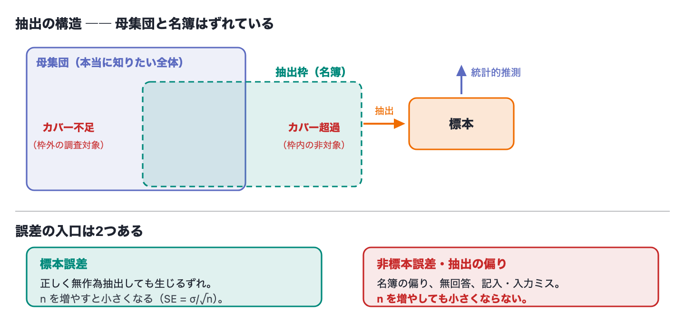

<!-- _class: lead -->
# 第6回　中心極限定理の再考
## CLTの魔法に隠れた「独立」という前提

統計学Ⅱ　2026後期　北星学園大学
小野原 彩香

---

## 今日のゴール

1. CLT：歪んだ母集団でも **独立な**標本平均は正規へ
2. 標準誤差 $\mathrm{SE}=\sigma/\sqrt{n}$、その**前提は独立**
3. 相関すると本当のばらつきが SE より大きい
4. **nを増やしても相関も偏りも消えない**

---

## 先に区別 ―― よく混同される2つ

| | 何を言っているか |
|---|---|
| **大数の法則** | $n$ を大きくすると、標本平均が**母平均 μ に近づく** |
| **中心極限定理** | $n$ を大きくすると、標本平均の分布の**形が正規に近づく** |

 

## 前者は「どこに寄るか」、後者は「どう散らばるか」

推定ができるのは前者のおかげ
**誤差の大きさが言える**のは後者のおかげ
―― どちらも **独立** が前提

---

## CLTの復習

母集団＝指数分布（平均10・右に長い裾、**正規でない**）
そこから独立に n=30 を選んで平均、を1万回

 

## → 標本平均はきれいな正規！

ばらつき（標準誤差）も理論どおり：

$$\mathrm{SE}=\frac{\sigma}{\sqrt{n}}$$

ここまではⅠの復習

---

## 契約書の細かい字

「**独立に** n=30 を選んで」 ← ここが効く

回答者が隣を気にして似た回答（空気を読む）＝相関

| n=30, σ=1 | 標本平均のばらつき |
|---|---|
| 素朴な SE σ/√n | 0.183 |
| 実際（独立 ρ=0） | 0.183 ← 一致 |
| 実際（相関 ρ=0.3） | **0.570 ＝ 約3倍** |

---

## 相関すると何が起きるか

本当のばらつきは σ/√n の **約3倍**

→ 実際はずっと不確実なのに、σ/√n を信じると
**過剰に自信を持つ**

 

> 検定なら **偽の有意差**
> 区間推定なら **狭すぎる信頼区間**（第7回）

---

## 最大のワナ：nを増やせば解決？

| n | 独立 ρ=0 | 相関 ρ=0.3 |
|---|---|---|
| 30 | 0.183 | 0.570 |
| 3000 | 0.018（ほぼ0） | **0.542（下がらない）** |

相関は $\sqrt{\rho}\approx0.55$ で **下げ止まる**

## 3000人集めても精密にならない

---

## もう1つ、nで直らないものがある

ここまでは**標本の中の相関**。もう1つは**誰を選んだか**

---

## 1936年 ―― 240万人を集めて18ポイント外した

米大統領選。*Literary Digest* 誌は約1,000万通を送り **約240万通**を回収

| | 値 |
|---|---|
| この $n$ での理論上の標本誤差 | **±0.06%** |
| 実際のずれ | 4割強と予測 → 実際は6割超。**約18ポイント** |

**理論上の標本誤差の約280倍、外している。** 原因は $n$ ではない

- **名簿の偏り**：電話帳・雑誌購読者名簿 → 高所得層＝共和党支持に偏る
- **無回答バイアス**：回収率は2割強。返した人と返さない人は同じでない

---

## 割当法は、無作為抽出の代わりにならない

年齢や性別の構成を母集団に似せて集める方法

- 無作為に抽出する → **結果として**母集団に似てくる
- 母集団に似せて抽出する → **無作為抽出にはならない**

 

似せられるのは**あらかじめ分かっている特性だけ**
調査の目的は**分かっていない特性**を知ること
→ **肝心の知りたい特性のほうが偏る**

---

## n は2つを直さない

- 標本の中が**相関** → 実効標本サイズは $1/\rho$ で頭打ち
- 抽出が**偏る** → いくら増やしても偏ったまま

 

## 数の多さは、独立性も代表性も買えない

「みんなが言っているから正しい」も同じ構造（第12〜13回）

---

## 今期の核心

空気を読んで似た答え →
**人数を集めても、独立な少人数ぶんの情報しかない**

 

> 「大勢が賛成だから確か」は、
> その大勢が互いを見て合わせているなら **無根拠**

→ 第13回 **コンドルセの陪審定理**
（独立な多数は賢い、空気を読む多数は賢くない）の正体

---

<!-- _class: lead -->
# 今日の課題

## CLTの前提の説明（自動採点）
## ＋「独立でないと推測は何を間違えるか」（記述）

### 次回：区間推定の理論
### 独立でない標本では「95%」が嘘になる
